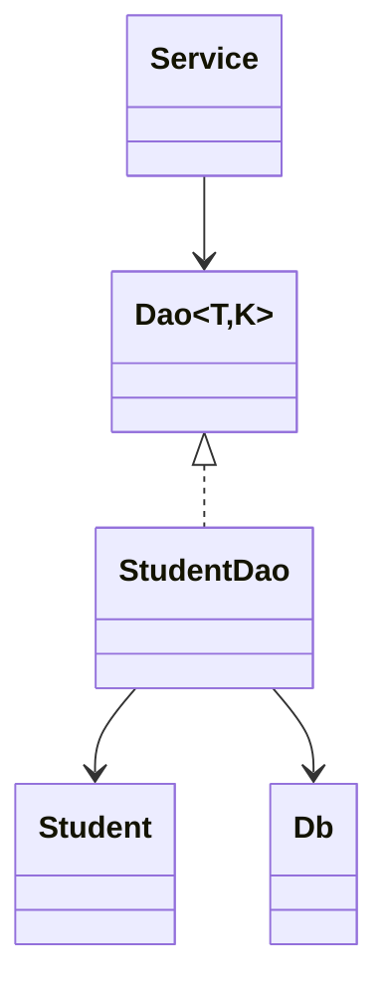

# A3 Generic data access design

## Repeated pattern and varying parts
StudentDB, CourseDB and MarksDB repeat connection acquisition, statement construction, parameter binding, execution, ResultSet traversal, mapping, error propagation and resource closing. Table/column names, key type, domain type, bound values and row-to-object mapping vary. Centralize the boundary behind a generic DAO contract; do not pretend generics automatically generate SQL or transactions.

| Contract | Meaning |
|---|---|
| Dao<T,K>.insert(T) | Persist one object |
| findById(K) to Optional<T> | Find zero or one object by primary key |
| findAll() to List<T> | Map every selected row |
| update(T) | Change one object's non-key fields |
| delete(K) to boolean | Report whether one row was removed |

## Generic design pseudocode
```text
INTERFACE Dao OF ObjectType T AND KeyType K
    INSERT(object T)
    FIND_BY_ID(key K) RETURNS OPTIONAL T
    FIND_ALL() RETURNS LIST OF T
    UPDATE(object T)
    DELETE(key K) RETURNS BOOLEAN
END INTERFACE

CLASS StudentDao IMPLEMENTS Dao OF Student AND String
    INSERT student using bound reg_no, name and email
    FIND_BY_ID using WHERE reg_no = bound key
    FIND_ALL using explicit columns ordered by reg_no
    MAP every row to Student(reg_no, name, email)
    UPDATE name and email using bound primary key
    DELETE using bound primary key
    CLOSE connection statement and result set on every path
    PROPAGATE SQL failures to the service boundary
END CLASS
```



## Object to table mapping

| Student field | SQL column | SQL type and rule |
|---|---|---|
| register String | reg_no | CHAR(9), primary key; leading zeros retained |
| name String | name | VARCHAR(80), NOT NULL |
| email String | email | VARCHAR(120), NOT NULL |

The primary key identifies the row; it is not inferred from object identity. PreparedStatement binds data, while ResultSet getters use the explicit column names. The executed StudentDao demonstrates all five operations in the dedicated test database.

## SQL inside services or GUI alternative
```text
ON GUI_SAVE
    OPEN connection
    BUILD student INSERT SQL in GUI
    BIND values and EXECUTE
    DISPLAY result
```
If the same query appears at s GUI/service sites, a column rename can require s code-site edits, plus the database migration. With StudentDao, student SQL/mapping is concentrated in one implementation file plus the migration; all affected SQL statements inside that file must still change. Dao<T,K> usually stays stable if the Java model property does not change. Identical SQL has the same database asymptotic time and result-memory requirements in both designs: indexed key lookup is typically O(log n) index work, findAll O(n) row work and O(n) retained output. DAO dispatch adds an ordinary constant method-call cost, not a new database algorithm. The main gain is ownership, testability and reduced scattered coupling, not guaranteed speed. Multi-operation transactions need a shared transaction boundary rather than opening unrelated connections in each DAO call.

## Reproduction and evidence

Compile with `python tools/compile.py`, then run `python tools/run.py A3` with the configured local database where needed. Supporting Java illustrates the design; the Part A pseudocode above is the design submission. Actual outputs, expected negative tests and compiler records are in results; screenshots show real terminal execution.
